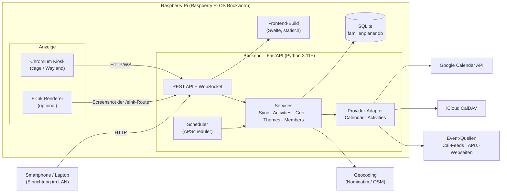
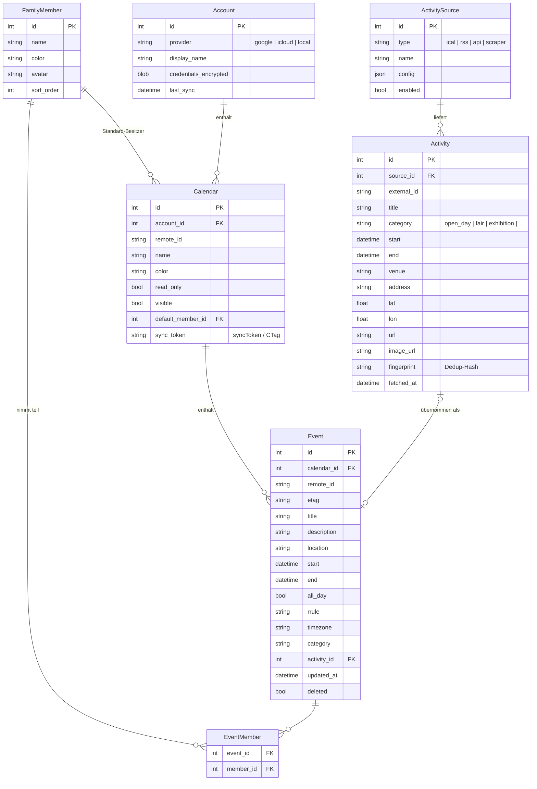
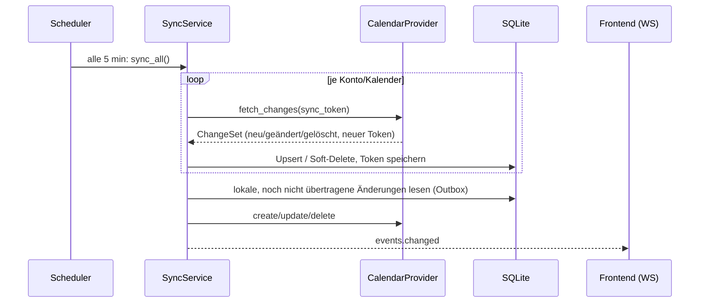
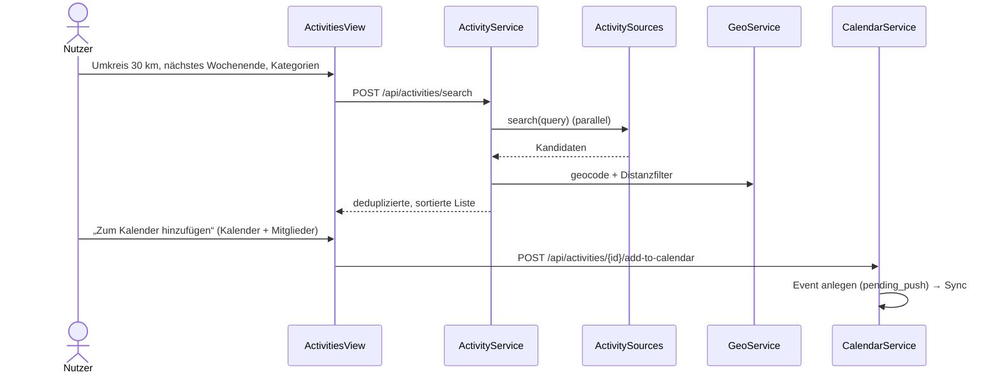

# Familienplaner – Architektur

> Stand: Architektur-Entwurf (v0.1). Dieses Dokument beschreibt Aufbau, Komponenten,
> Datenmodell, Schnittstellen und Deployment. Die Funktionen selbst sind noch **nicht**
> implementiert. Das Code-Gerüst enthält nur Schnittstellen und Platzhalter.

---

## 1. Ziele & Anforderungen

| # | Anforderung | Architektur-Antwort |
|---|-------------|---------------------|
| F1 | Kalender mit **Monats- und Wochenansicht** | Frontend-Views `MonthView`, `WeekView` |
| F2 | **Tabellarische Ansicht pro Familienmitglied** (Spalten = Personen, Zeilen = Tage/Zeitslots) | Frontend-View `FamilyTableView`, Termine werden über `Event.member_ids` zugeordnet |
| F3 | Anbindung **Google Kalender** | `GoogleCalendarProvider` (Google Calendar API v3, OAuth2 Device Flow) |
| F4 | Anbindung **Apple-/iCloud-Kalender** | `ICloudCalendarProvider` (CalDAV, app-spezifisches Passwort) |
| F5 | **Wählbare Farbschemata** | Theme-System über Design-Tokens (CSS Custom Properties) + Theme-JSON |
| F6 | **Freizeitaktivitäten im Umkreis suchen** (Tag der offenen Tür, Messen, Ausstellungen …) und in den Kalender übernehmen | `ActivityService` mit austauschbaren `ActivitySource`-Plugins, Geocoding und Umkreisfilter |
| N1 | Läuft auf **Raspberry Pi** mit 10–12"-Display | Leichtgewichtiges Backend (Python/FastAPI) + statisches Frontend in Chromium-Kiosk |
| N2 | Alternative **E-Ink-Anzeige** | Separater Render-Pfad: Server-seitiger Screenshot → Dithering → E-Ink-Treiber |
| N3 | Offline-fähig / robust | Lokaler SQLite-Cache, Sync im Hintergrund, Anzeige funktioniert ohne Internet |
| N4 | Bedienbar ohne Tastatur am Pi | Touch-optimierte UI. Einrichtung (Logins, Einstellungen) bequem per Smartphone/Laptop im Heimnetz |
| N5 | Datenschutz | Alles lokal auf dem Pi. Tokens verschlüsselt. Kein Cloud-Backend eigener Art |

---

## 2. Systemüberblick



**Grundprinzipien**

1. **Local-first:** Die Anzeige liest immer aus der lokalen DB. Externe Kalender werden im Hintergrund synchronisiert.
2. **Ports & Adapters (hexagonal):** Die Fachlogik kennt nur Schnittstellen (`CalendarProvider`, `ActivitySource`, `EInkDriver`). Google, iCloud, konkrete Event-Portale und Display-Hardware sind austauschbare Adapter.
3. **Eine UI, zwei Ausgabewege:** Dasselbe Frontend dient für das LCD (interaktiv) und für E-Ink (statischer Screenshot einer speziellen Route mit E-Ink-Theme).
4. **Konfiguration per Web:** Der Pi wird nach der Ersteinrichtung nicht mehr mit Tastatur bedient.

---

## 3. Technologie-Stack

| Schicht | Wahl | Begründung |
|---------|------|------------|
| Hardware | Raspberry Pi 4 (4 GB) oder Pi 5. Offizielles 10"/11"-Touch-Display oder HDMI-Touch-Display. Alternativ Waveshare 13.3" / Pimoroni Inky Impression 7.3" (E-Ink) | Genug Leistung für Chromium. E-Ink-Treiber für Python vorhanden |
| OS | Raspberry Pi OS Lite (Bookworm, 64 bit) | Schlank, kein Desktop nötig |
| Kiosk | `cage` (Wayland-Kiosk-Compositor) + Chromium `--kiosk` | Minimaler Overhead, automatischer Start |
| Backend | Python 3.11+, **FastAPI**, Uvicorn | Async, schnell, gute Libraries für CalDAV, Google API und E-Ink |
| Persistenz | **SQLite** + SQLModel (SQLAlchemy) + Alembic | Keine Server-DB nötig, einfache Backups |
| Hintergrundjobs | APScheduler (im Backend-Prozess) | Kein separater Broker auf dem Pi nötig |
| Kalender-Libs | `google-api-python-client`, `google-auth-oauthlib`. `caldav`, `icalendar`, `python-dateutil` (RRULE) | Etablierte Standards |
| Activities | `httpx`, `selectolax`/`beautifulsoup4` (Scraper), `icalendar`, `geopy` | Plugin-basiert |
| Frontend | **Svelte 5 + Vite + TypeScript**, statischer Build | Sehr kleiner Bundle-Footprint → flüssig auf dem Pi |
| Theming | CSS Custom Properties, Theme-Definitionen als JSON | Laufzeit-Umschaltung ohne Rebuild |
| E-Ink-Render | Playwright (headless Chromium) → PNG → Pillow (Dithering) → Treiber | Wiederverwendung der Web-Views |
| Deployment | systemd-Units, Install-Skript. Optional Docker Compose | Robust, startet nach Stromausfall von selbst |

---

## 4. Komponenten

### 4.1 Backend-Module

```
backend/app/
├── main.py                 App-Factory, Router-Registrierung, Lifespan (DB, Scheduler)
├── config.py               Settings (YAML + Umgebungsvariablen)
├── core/
│   ├── db.py               Engine, Session-Handling
│   ├── security.py         Token-Verschlüsselung (Fernet), Admin-PIN
│   ├── scheduler.py        Job-Registrierung (Sync, Activity-Refresh, E-Ink, Nachtmodus)
│   └── events.py           Interner Event-Bus → WebSocket-Push an das Frontend
├── domain/
│   └── models.py           Entitäten (siehe Kap. 5)
├── providers/
│   ├── calendar/
│   │   ├── base.py         Port: CalendarProvider
│   │   ├── google.py       Adapter: Google Calendar API
│   │   └── icloud.py       Adapter: iCloud CalDAV
│   └── activities/
│       ├── base.py         Port: ActivitySource
│       ├── ical_feed.py    Adapter: generische iCal/ICS-Feeds (Museen, Schulen, Städte)
│       ├── rss_feed.py     Adapter: RSS/Atom-Veranstaltungsfeeds
│       ├── ticketmaster.py Adapter: Ticketmaster Discovery API (Beispiel für API-Quelle)
│       └── scraper.py      Adapter: konfigurierbarer HTML-Scraper (pro Website eine Regel)
├── services/
│   ├── sync_service.py     Zwei-Wege-Sync lokaler Termine ↔ externe Kalender
│   ├── calendar_service.py Abfragen für Monats-/Wochen-/Familienansicht
│   ├── member_service.py   Familienmitglieder, Zuordnung Kalender → Person
│   ├── activity_service.py Suche, Deduplizierung, Übernahme in den Kalender
│   ├── geo_service.py      Geocoding, Umkreisberechnung (Haversine), Cache
│   └── theme_service.py    Theme-Verwaltung
├── api/
│   ├── calendar.py         /api/events, /api/calendars
│   ├── members.py          /api/members
│   ├── activities.py       /api/activities (Suche, Übernahme, Quellen)
│   ├── accounts.py         /api/accounts (Google-/iCloud-Verknüpfung)
│   ├── settings.py         /api/settings, /api/themes
│   └── display.py          /api/display (Helligkeit, Nachtmodus, E-Ink-Trigger), /ws
└── display/eink/
    ├── renderer.py         Screenshot → Dithering → Treiber
    └── drivers/
        ├── base.py         Port: EInkDriver
        ├── waveshare.py    Adapter: Waveshare-Panels
        └── inky.py         Adapter: Pimoroni Inky
```

### 4.2 Frontend-Module

```
frontend/src/
├── App.svelte              Shell: Navigation (Tab-Leiste), Uhr/Datum, Theme-Provider
├── lib/
│   ├── api.ts              Typisierter REST-Client
│   ├── ws.ts               WebSocket-Client (Live-Updates nach Sync)
│   ├── types.ts            Gemeinsame Typen (gespiegelt aus Backend-Schemas)
│   ├── stores.ts           Svelte-Stores: aktuelle Ansicht, Datum, Theme, Mitglieder
│   └── theme.ts            Laden/Anwenden der Design-Tokens
├── views/
│   ├── MonthView.svelte
│   ├── WeekView.svelte
│   ├── FamilyTableView.svelte
│   ├── ActivitiesView.svelte   Suche im Umkreis, Ergebnisliste, „Zum Kalender hinzufügen“
│   ├── SettingsView.svelte     Konten, Mitglieder, Themes, Display, Activity-Quellen
│   └── EInkView.svelte         Statische, kontrastreiche Ansicht für E-Ink-Screenshots
├── components/             EventChip, DayCell, MemberBadge, EventDialog, ThemePicker …
└── themes/                 *.json Theme-Definitionen
```

**Routen**

| Route | Zweck | Ziel |
|-------|-------|------|
| `/#/month` | Monatsansicht | LCD |
| `/#/week` | Wochenansicht | LCD |
| `/#/family` | Tabelle nach Familienmitgliedern | LCD |
| `/#/activities` | Freizeitaktivitäten suchen | LCD / Smartphone |
| `/#/settings` | Einstellungen (PIN-geschützt) | primär Smartphone |
| `/#/eink?layout=week` | Render-Ziel für E-Ink | Headless-Browser |

---

## 5. Datenmodell



Außerdem einfache Key-Value-Tabellen für `Settings` (Theme, Heimatort, Umkreis, Nachtmodus …) und einen `GeocodeCache`.

**Zuordnung Termine → Familienmitglieder** (für die Tabellenansicht):
1. Explizit über `EventMember` (in der UI gesetzt).
2. Fallback: `Calendar.default_member_id` (z. B. „Kalender *Lena Schule* gehört zu Lena“).
3. Optional: Regeln (z. B. Teilnehmer-E-Mail → Person). Später erweiterbar.

---

## 6. Schnittstellen (Ports)

### 6.1 `CalendarProvider`

```python
class CalendarProvider(Protocol):
    provider_id: str                                       # "google" | "icloud"
    async def authenticate(self, account: Account) -> None
    async def list_calendars(self) -> list[RemoteCalendar]
    async def fetch_changes(self, calendar: Calendar,
                            sync_token: str | None) -> ChangeSet   # delta sync
    async def create_event(self, calendar: Calendar, event: EventDraft) -> RemoteEvent
    async def update_event(self, calendar: Calendar, event: Event) -> RemoteEvent
    async def delete_event(self, calendar: Calendar, event: Event) -> None
```

| | Google | iCloud |
|---|---|---|
| Protokoll | REST (Calendar API v3) | CalDAV (`https://caldav.icloud.com`) |
| Auth | OAuth2 **Device Flow** (Code wird am Pi angezeigt und am Handy bestätigt) | Apple-ID + **app-spezifisches Passwort** |
| Delta-Sync | `syncToken` | CTag/ETag bzw. `sync-collection` (RFC 6578) |
| Push | optional Webhooks (benötigt öffentliche URL → im MVP **Polling**) | Polling |

### 6.2 `ActivitySource`

```python
class ActivitySource(Protocol):
    source_type: str
    async def search(self, query: ActivityQuery) -> list[ActivityCandidate]
    # ActivityQuery: center(lat, lon), radius_km, date_from, date_to,
    #                categories, keywords
```

Der `ActivityService` führt die Suche über alle aktiven Quellen aus und:
1. **normalisiert** die Ergebnisse,
2. **geocodiert** Adressen ohne Koordinaten (Nominatim, gecacht, max. 1 Anfrage/s),
3. **filtert** nach Umkreis (Haversine) und Zeitraum,
4. **dedupliziert** (Fingerprint aus normalisiertem Titel, Datum und Ort),
5. **kategorisiert** (Regeln/Schlüsselwörter, später optional per LLM),
6. übernimmt auf Wunsch eine Aktivität als `Event` in einen gewählten Kalender, für gewählte Mitglieder.

**Mögliche Quellen** (über Konfiguration hinzufügbar, ohne Code-Änderung bei iCal/RSS):
- iCal-/RSS-Feeds von Städten, Museen, Messegeländen, Schulen, Hochschulen (Tag der offenen Tür)
- Event-APIs mit Geo-Suche (z. B. Ticketmaster Discovery, Eventbrite nur für eigene Organisationen)
- Regionale Veranstaltungsportale per Scraper-Regel (Nutzungsbedingungen und `robots.txt` beachten)

### 6.3 `EInkDriver`

```python
class EInkDriver(Protocol):
    width: int
    height: int
    palette: list[tuple[int, int, int]]     # z. B. Schwarz/Weiß oder 7 Farben
    def display(self, image: "PIL.Image.Image") -> None
    def clear(self) -> None
    def sleep(self) -> None
```

### 6.4 REST-API (Übersicht)

| Methode | Pfad | Beschreibung |
|---|---|---|
| GET | `/api/events?from=&to=&members=` | Termine im Zeitraum |
| POST/PUT/DELETE | `/api/events[/{id}]` | Termin anlegen/ändern/löschen (wird zurückgespielt) |
| GET | `/api/calendars` | Kalender inkl. Sichtbarkeit, Farbe, Standard-Mitglied |
| GET/POST/PUT/DELETE | `/api/members` | Familienmitglieder |
| POST | `/api/accounts/google/device-code` | Startet den Google Device Flow |
| POST | `/api/accounts/icloud` | iCloud-Konto verknüpfen |
| POST | `/api/sync` | Sync manuell auslösen |
| POST | `/api/activities/search` | Umkreissuche |
| POST | `/api/activities/{id}/add-to-calendar` | Aktivität übernehmen |
| GET/POST | `/api/activities/sources` | Quellen verwalten |
| GET | `/api/themes` · PUT `/api/settings` | Themes & Einstellungen |
| POST | `/api/display/eink/refresh` | E-Ink-Neuzeichnung |
| WS | `/ws` | Push: `events.changed`, `sync.status`, `theme.changed` |

---

## 7. Zentrale Abläufe

### 7.1 Kalender-Synchronisation



- **Konfliktregel (MVP):** „Last write wins“ anhand `updated`/ETag. Remote gewinnt bei Gleichstand.
- **Wiederkehrende Termine:** Gespeichert wird die RRULE. Die Expansion in Einzeltermine passiert beim Lesen für das angefragte Zeitfenster.
- **Outbox-Muster:** Lokale Änderungen landen zuerst in der DB (Flag `pending_push`). Dadurch funktioniert das Eintragen auch offline.

### 7.2 Aktivität suchen & hinzufügen



### 7.3 E-Ink-Aktualisierung

1. Der Scheduler löst den Job aus (z. B. alle 15 min sowie nach `events.changed`, mit Debounce).
2. Playwright öffnet `http://localhost:8000/#/eink?layout=week` in der Auflösung des Panels.
3. Der Screenshot wird mit Pillow auf die Panel-Palette quantisiert (Floyd-Steinberg-Dithering).
4. Der `EInkDriver` zeichnet das Bild. Danach geht das Panel in den Ruhezustand.
5. Ist das Bild unverändert (Hash-Vergleich), wird nicht neu gezeichnet. Das schont das Panel.

---

## 8. Theme-System

- Jedes Theme ist eine JSON-Datei mit **Design-Tokens**:

```json
{
  "id": "nordic",
  "name": "Nordisch",
  "mode": "light",
  "tokens": {
    "bg": "#F5F7FA", "surface": "#FFFFFF", "text": "#1F2933",
    "text-muted": "#616E7C", "accent": "#3E7CB1", "border": "#D9E2EC",
    "today": "#FFF3C4", "weekend": "#EEF2F6"
  },
  "memberPalette": ["#E4572E", "#29335C", "#F3A712", "#669BBC", "#7FB069"],
  "font": { "family": "Inter", "scale": 1.0 }
}
```

- Das Frontend setzt die Tokens als `--color-*`-Variablen auf `:root`. Komponenten verwenden **nur** Variablen.
- Mitgelieferte Themes: *Hell*, *Dunkel*, *Nordisch*, *Pastell (Kinder)*, *Hoher Kontrast*, *E-Ink S/W*, *E-Ink 7-Farben*.
- Optionaler **Auto-Wechsel**: Tag- und Nacht-Theme nach Uhrzeit oder Sonnenauf- und -untergang.
- Farben der Familienmitglieder bleiben über alle Themes gleich (pro Mitglied gespeichert). Das Theme liefert nur Vorschläge.

---

## 9. Sicherheit & Datenschutz

- Das Backend lauscht nur im Heimnetz (Bind an LAN-Interface, Firewall `ufw`). Erreichbar per mDNS als `familienplaner.local`.
- **Einstellungen und Konten** sind durch eine Admin-PIN geschützt (Session-Cookie). Die Kalenderanzeige ist ohne PIN sichtbar.
- OAuth-Tokens und das iCloud-Passwort werden mit Fernet verschlüsselt gespeichert. Der Schlüssel liegt in `/etc/familienplaner/secret.key` (Rechte 600).
- Der Google-OAuth-Client ist ein eigener Client des Nutzers (Typ „TV & Limited Input“). Scopes: `calendar.events`, `calendar.readonly`.
- Backups: tägliche Kopie der SQLite-DB (`sqlite3 .backup`), optional auf einen USB-Stick oder ein NAS.

---

## 10. Deployment auf dem Raspberry Pi

```
/opt/familienplaner/
├── backend/            (venv unter .venv)
├── frontend/dist/      (statischer Build, vom Backend ausgeliefert)
/etc/familienplaner/
├── config.yaml
└── secret.key
/var/lib/familienplaner/
├── familienplaner.db
└── backups/
```

**systemd-Units**

| Unit | Aufgabe |
|------|---------|
| `familienplaner-backend.service` | Uvicorn auf `0.0.0.0:8000` |
| `familienplaner-kiosk.service` | `cage -- chromium --kiosk http://localhost:8000` als Benutzer `kiosk`, Autologin auf tty1 |
| `familienplaner-eink.service` *(optional)* | Läuft statt Kiosk, wenn `display.mode = eink`. Startet den Renderer-Loop |

**Display-Management**
- Nachtmodus: Display zu konfigurierbaren Zeiten aus (`wlr-randr` / Backlight-Sysfs), Aufwecken per Touch.
- Optional ein PIR-Bewegungssensor an GPIO, der das Display einschaltet.

**Build-Strategie:** Das Frontend wird auf dem Entwicklungsrechner oder in CI gebaut, nur `dist/` wird übertragen. Auf dem Pi ist kein Node.js nötig.

---

## 11. Varianten LCD vs. E-Ink

| | LCD (10–12" Touch) | E-Ink (7,3"–13,3") |
|---|---|---|
| Interaktion | voll (Touch) | keine. Bedienung per Smartphone |
| Aktualisierung | live (WebSocket) | periodisch (15–60 min) |
| Ansichten | alle | Woche **oder** Familientabelle (konfigurierbar), ohne Animationen |
| Themes | alle | nur E-Ink-Themes (S/W, 7 Farben) |
| Stromverbrauch | ca. 5–8 W | < 1 W im Mittel. Pi Zero 2 W möglich |

---

## 12. Erweiterbarkeit (spätere Ausbaustufen)

- Weitere Kalender: Outlook/Microsoft 365 (Graph API) als zusätzlicher `CalendarProvider`
- Aufgaben/Einkaufsliste, Wetter-Widget, Müllabfuhrkalender (iCal)
- LLM-gestützte Extraktion von Veranstaltungen aus beliebigen Webseiten
- Sprachsteuerung / Home-Assistant-Integration (MQTT)

---

## 13. Umsetzungsplan (nächste Schritte)

1. **Fundament:** DB-Modelle, Migrationen, Settings, App-Shell, Theme-System
2. **Ansichten mit lokalen Daten:** Monat, Woche, Familientabelle, Termin-Dialog
3. **Google-Sync** (Device Flow, Delta-Sync, Outbox)
4. **iCloud-Sync** (CalDAV)
5. **Activities:** Geo-Service, iCal-/RSS-Quellen, Suche und Übernahme
6. **Deployment:** Install-Skript, Kiosk, Nachtmodus
7. **E-Ink-Pfad:** Renderer und Treiber
